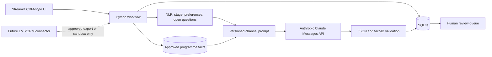

# LeadPilot AI
### Project 029 · Lead Follow-up Email & WhatsApp Draft Assistant

Turn synthetic enquiry history into concise, personalized follow-up **drafts**. LeadPilot combines a lightweight NLP pipeline, approved programme facts, Anthropic Claude, response validation and SQLite. A person reviews every draft; approved Email drafts can be sent only through a separately configured SMTP action. WhatsApp remains draft-only, and the prototype has no production CRM capability.

> **Human approval is mandatory.** Email is sent only after approval and a separate explicit send action. Nothing is scheduled or written to a production LMS/CRM.

## What it does

- Maintains leads, inbound/outbound interactions and approved programme facts.
- Detects conversation stage, stated preferences, question topics, and topics not mentioned in an outbound reply.
- Creates channel-aware Email or WhatsApp drafts through the real Anthropic Messages API.
- Sends approved Email drafts through encrypted SMTP only after a separate human action.
- Validates the JSON structure and approved fact IDs before persisting a draft.
- Records NLP output, provider/model, prompt version, review feedback and audit events in SQLite.
- Provides a Streamlit dashboard, lead workspace, draft generator, and human review queue.

The topic-answering classifier is intentionally heuristic: it considers a topic addressed when an outbound interaction mentions that topic. It does not determine whether the answer is semantically complete; a human must verify it.

## Quick start (Windows PowerShell)

Use Python 3.10 or later. From the project folder:

```powershell
py -m venv .venv
.\.venv\Scripts\Activate.ps1
python -m pip install --upgrade pip
pip install -r requirements.txt
```

Create a local `.env` only if you do not already have one:

```powershell
if (-not (Test-Path .env)) { Copy-Item .env.example .env }
```

Edit `.env` with your own Anthropic key and, if needed, a model available to your account. Add SMTP settings only if you intend to send email:

```env
ANTHROPIC_API_KEY=your_anthropic_api_key
ANTHROPIC_MODEL=claude-sonnet-4-5
DATABASE_PATH=data/lead_assistant.db
SMTP_HOST=
SMTP_PORT=587
SMTP_USERNAME=
SMTP_PASSWORD=
SMTP_FROM_EMAIL=
SMTP_SECURITY=starttls
```

Keep `.env` private. It is ignored by Git; do not paste keys into source code, issue reports, screenshots, or chat. Never commit the key. If the configured model is unavailable to your account, set `ANTHROPIC_MODEL` to an Anthropic model you can access.

For provider setup and safe retry guidance, see [docs/EMAIL_SENDING.md](docs/EMAIL_SENDING.md).

Initialize the SQLite database and run the app:

```powershell
python init_db.py
streamlit run app.py
```

Open the local Streamlit URL printed in the terminal. The sample dataset is synthetic and initialization is safe to repeat. The app reports missing credentials or API errors and does not create a draft on failure. The runtime database in `data/` is local and ignored by Git.

The package also includes a clean synthetic SQLite fixture at `sample_data/lead_assistant_sample.db`. To regenerate it:

```powershell
python init_db.py --sample-output
```

Sign in with user ID `admin` and password `admin@123`. This is a shared, hardcoded demo gate for local demonstrations only—not production authentication or protection for sensitive data.

## Try the end-to-end scenario

1. Select the synthetic Aarav Sharma lead.
2. Inspect the history and NLP result: beginner/weekend preferences and open fee, placement and recording topics.
3. Generate an Email or WhatsApp draft. With valid Anthropic credentials and available API credits, this calls the live Anthropic API.
4. Inspect the generated draft, response metadata, fact IDs and human-review notes.
5. Open **Review Drafts** and approve, reject or request changes.
6. To test delivery, add a real recipient, configure SMTP, approve an Email draft, and then use the separate **Send email** action. The seeded `@email.test` address is blocked.

`sample_data/expected_draft.json` is an illustrative, non-live example. A real provider response and saved database row are produced only when the app is run with valid credentials.

## Tests

```powershell
python -m pytest -v
```

Tests use fake Anthropic and SMTP transports and do not require keys, network access or paid API usage. They cover 50 automated normal and edge cases, including validation, NLP, SQLite, AI Engineering fact seeding, missing-fact blocking, the integrated workflow, Anthropic configuration failure and response validation. See [docs/TEST_PLAN.md](docs/TEST_PLAN.md) for case-by-case expected and actual results.

## Architecture



See [docs/ARCHITECTURE.md](docs/ARCHITECTURE.md) for the full workflow and [docs/DEMO_SCRIPT.md](docs/DEMO_SCRIPT.md) for a live walkthrough.

## Project layout

```text
app.py                       Streamlit interface
init_db.py                   Database initialization and sample seeding
schema.sql                   SQLite tables, keys, indexes and relationships
.streamlit/config.toml       Brand theme and accessible contrast
lead_assistant/
  config.py                  Environment-based settings
  database.py                SQLite CRUD, sample data and audit logging
  email_sender.py            SMTP transport and recipient validation
  nlp.py                     Text cleaning, tokenization and heuristic analysis
  prompts.py                 Versioned system/task prompt pack
  llm.py                     Anthropic API client and response validation
  workflow.py                Fetch → analyze → draft → validate → save
sample_data/                 Synthetic input/output and packaged SQLite fixture
data/lead_assistant.db       Local runtime database (not committed)
prompt_pack/                 Prompt design notes and expected JSON contract
docs/                        Architecture, email setup, test evidence and demo
tests/                       Offline automated tests
```

## Data, privacy and limitations

- Seeded names, contacts and messages are synthetic; programme facts are not verified real policies. User-entered real contacts should be handled only in an appropriately secured deployment.
- No LMS/CRM scraping, private endpoint access, or production integration is implemented. Email sending is explicit and SMTP-based; messages are never sent automatically.
- Only facts marked approved for the selected programme are passed to Claude. Drafts remain untrusted until a human checks them.
- Fact-ID validation checks references and JSON shape, not whether prose is semantically entailed by a fact.
- NLP uses transparent keyword/rule heuristics rather than a trained model. Outbound topic matching does not guarantee that an enquiry was fully answered.
- The database is a local SQLite mirror. A future CRM connector requires approved documentation and a sandbox/export.

## Submission checklist

- [x] Modular Python application, validation and exception handling
- [x] Meaningful NLP stage, preference and question-topic analysis
- [x] Anthropic API integration, configurable model and timeout/error handling
- [x] SQLite schema, sample records, CRUD, audit and human review
- [x] Prompt pack, workflow diagram, sample scenario and setup guide
- [x] 50 automated edge/normal-case tests with actual results
- [x] GitHub repository: https://github.com/jhariyakamlesh2/Project_029_Lead_Followup_Assistant
- [ ] Record the live walkthrough locally (one normal flow and one API-configuration failure); see [docs/DEMO_SCRIPT.md](docs/DEMO_SCRIPT.md)
- [ ] Add a deployed/demo URL if a public deployment is approved and available
