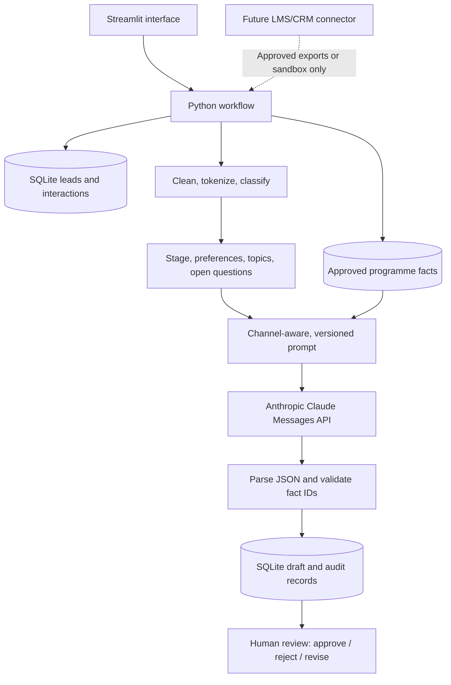

# Architecture and workflow

## Request lifecycle

1. The user selects a lead and draft channel. The app fetches the lead and chronological interactions from SQLite.
2. NLP cleans and tokenizes inbound messages, estimates the conversation stage, detects preference keywords and question topics, and compares topics with outbound interactions. This last step is a topic-match heuristic, not semantic answer verification.
3. The workflow retrieves only approved facts for the lead's programme. Missing facts are not filled from model knowledge.
4. A versioned prompt labels lead/history/fact fields as untrusted data and requests a strict JSON object with claim-level fact IDs.
5. `AnthropicDraftGenerator` calls the Anthropic Messages API with a bounded timeout. It parses the text response and validates required fields, claim citations and fact IDs.
6. Only a validated draft is inserted into SQLite, initially as `Pending Approval`, with provider/model, NLP JSON, fact IDs and an audit event.
7. A reviewer records `Approved`, `Rejected` or `Needs Changes` with feedback. This workflow does not send the message.

## Boundaries

- `lead_assistant/database.py`: local SQLite persistence and audit history.
- `lead_assistant/nlp.py`: deterministic, explainable text heuristics.
- `lead_assistant/prompts.py`: prompt version and output contract.
- `lead_assistant/llm.py`: Anthropic API boundary and response checks.
- `lead_assistant/workflow.py`: orchestration independent of the UI.
- `app.py`: CRM-style human interface.
- Future LMS/CRM connector: intentionally separate; requires approved documentation, exports or a developer-provided sandbox.

